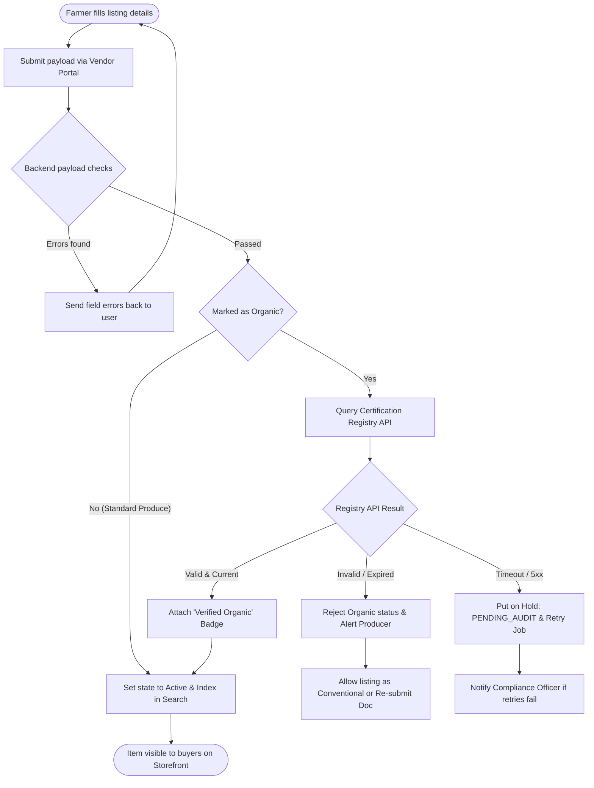

# Business Process Analysis & Organisational Responsibilities: Use Case 1

## 1. Project Background and Operational Scope

Within our distributed marketplace architecture, **Use Case 1 (Producer Product Onboarding and Inventory Tracking)** handles everything on the supplier side before a customer can place an order. The main goal here is straightforward: give verified agricultural suppliers (farmers, local growers, and cooperatives) a clean way to catalog their items, keep inventory counts synced in real time, confirm genuine organic credentials, and manage seasonal availability automatically so customers aren't buying produce that isn't currently harvested.

This document walks through the full journey of a product listing. We examine how an item moves from an initial vendor submission draft to an active catalog item, how validations and external API calls work under the hood, how stock updates trigger automatic status switches, and exactly which stakeholder or system service is accountable at every stage.

---

## 2. Actors and System Roles

To keep system boundaries clear and follow good microservice/enterprise separation of concerns, this use case involves four primary roles:

| Participant / Component | Classification | Description & Scope of Responsibility |
| :--- | :--- | :--- |
| **Agricultural Producer** | External User (Vendor) | The authenticated farmer or supplier who logs into the vendor portal to list items, specify harvest batches, declare stock numbers, and upload organic certification numbers. |
| **Marketplace Core Backend** | System / Platform Engine | The internal application services handling web requests, input sanitization, database persistence, state transitions, search indexing, and scheduled background jobs. |
| **Certification Body (API)** | Third-Party Integration | An external certifying service (such as Soil Association or national organic register endpoints) that validates whether a provided license key is genuine and active. |
| **Compliance & Quality Reviewer** | Internal Staff | Marketplace back-office administrator who steps in to manually review edge cases, inspect flagged licenses, or resolve supplier disputes when automatic checks fail. |

---

## 3. End-to-End Workflow Architecture

Here is the operational flow covering how an item gets submitted, checked by backend rules, validated against the organic licensing registry (if applicable), and finally listed on the marketplace:



---

## 4. Detailed Breakdown of the Six Core Business Processes

### 4.1. Process 1: Product Submission
* **Purpose:** Collect all necessary product specs, batch details, pricing, and regulatory flags directly from the producer without missing key information.
* **How it triggers:** The authenticated producer navigates to their seller dashboard and opens the "Add New Product" form.
* **Information Collected:**
  * **Basic Commercial Data:** Name of item, description, parent category (e.g., Seasonal Greens, Root Veg, Orchard Fruits, Fresh Dairy), base price in GBP (£), and unit sold by (e.g., per kg, crate, bunch, or litre).
  * **Batch & Storage Numbers:** Opening warehouse/farm inventory count, unique harvest batch number, date harvested, and estimated shelf-life / best-before date.
  * **Origin & Food Safety:** Registered farm name and location coordinates, along with allergen disclosures (such as nuts, celery, mustard, etc.).
  * **Certification Details:** Organic checkbox toggle, accompanied by the official Organic License Reference code where applicable.
  * **Availability Window:** Expected start date and expected final harvest cutoff date.
* **Resulting System State:** A new draft record is stored in the database with status set to `SUBMITTED`.

---

### 4.2. Process 2: Product Validation
* **Purpose:** Catch typos, negative values, and inconsistent dates immediately so bad data never pollutes the live search index.
* **How it triggers:** Fires as soon as the API endpoint receives the listing payload from the vendor portal.
* **Validation Rules Applied:**
  1. **Required Fields Check:** Ensures mandatory attributes (title, category, unit price, stock count, farm location, best-before date) are present and not empty strings.
  2. **Sensible Numeric Bounds:** Price must be strictly greater than £0.00; declared stock quantity must be an integer of 1 or higher.
  3. **Date Consistency Logic:**
     * `Harvest Date` cannot be in the future (must be $\le$ today).
     * `Best-Before Date` must be in the future (strictly $>$ today).
     * `Seasonality Start Date` must come before `Seasonality End Date`.
* **Flow Branching:**
  * **If checks fail:** The system rejects the save, rolls back any pending transaction, and sends back specific JSON error pointers so the frontend can highlight the exact fields requiring correction.
  * **If checks pass:** The listing progresses to the `VALIDATED` stage and enters the next routing checkpoint.

---

### 4.3. Process 3: Organic Certification Verification
* **Purpose:** Make sure customers aren't misled by false claims, preserving platform credibility and meeting legal trade standards.
* **How it triggers:** Automatically invoked whenever a `VALIDATED` item has its `is_organic` flag set to true.
* **Operational Flow:**
  1. The platform issues a secure outbound call to the designated Organic Licensing Authority API, passing the producer's registered business identity along with the claimed certificate registration number.
  2. **Outcome 1 - Valid License:** The registry returns a success code with the certificate's expiration date. The platform stamps an audit log entry, applies a verified green badge to the product profile, and proceeds directly to publication.
  3. **Outcome 2 - Invalid or Expired License:** If the authority reports the license doesn't exist or has lapsed, the organic claim is rejected. The producer is sent an email/portal alert explaining the issue and is given the option to publish the produce as conventional (unbadged) or upload fresh paperwork.
  4. **Outcome 3 - Upstream Outage / Timeout:** If the external registry is down (returning 502/503 errors or timing out after 5 seconds), the system does not crash or abandon the product. It marks the record as `PENDING_AUDIT` and schedules a background worker to retry three times with exponential backoff. If all retries fail, it creates an alert ticket for the internal Compliance Officer to review manually.

---

### 4.4. Process 4: Product Publication
* **Purpose:** Push approved products into the public catalog so shoppers can find and purchase them.
* **How it triggers:** Reached once all data validations and certification verifications (if required) finish successfully.
* **Actions Performed:**
  1. Record status changes from `VALIDATED` to `ACTIVE_LISTED`.
  2. Search and filter indexes are refreshed (e.g., Elasticsearch / PostgreSQL full-text index), making the product discoverable via search bars, category tags, and direct share URLs.
  3. A push notification and email confirmation are dispatched to the producer confirming their listing is now live.

---

### 4.5. Process 5: Real-Time Inventory Tracking
* **Purpose:** Keep stock counts reliable across simultaneous buyer sessions and avoid awkward overselling situations.
* **Mechanisms:**
  * **Decrementing on Checkout:** As soon as an order is completed in Use Case 2, our inventory service deducts the purchased units using atomic database queries (`WHERE stock >= requested_quantity`) so two buyers checking out at the exact same second cannot purchase the same remaining unit.
  * **Zero-Inventory Cutoff:** When physical quantity drops to 0, the platform immediately flips the item's state to `OUT_OF_STOCK` and removes the "Add to Cart" button on the storefront.
  * **Restocking Procedure:** When the farmer harvests another batch and enters updated stock via their portal, the system first verifies that the calendar still falls within the declared seasonal window. If valid, the item transitions right back to `ACTIVE_LISTED`.

---

### 4.6. Process 6: Seasonal Availability Management
* **Purpose:** Prevent customers from ordering produce outside of its actual harvesting window, even if extra units were left on record.
* **Mechanisms:**
  * **Configured Season Boundaries:** Every listing carries a defined operational date window (`season_start` through `season_end`).
  * **Scheduled Nightly Daemon:** A cron job runs every night at 00:00 UTC, scanning active listings against the current date.
  * **Automatic End-of-Season Suspension:** If the current date runs past `season_end`, the system switches the status to `SEASONAL_SUSPENSION`. The item stays visible in the farmer's private management area for next year, but cannot be browsed or bought by customers.
  * **Season Opening Reactivation:** When a previously scheduled item reaches its `season_start` date and has positive stock on record, the batch engine automatically flips it back to `ACTIVE_LISTED`.

---

## 5. Product Lifecycle & Status Transitions

Below is a summary of how a product transitions across different lifecycle states based on user actions, background scheduled jobs, and purchasing activity:

| Starting State | Trigger Condition | System Action | New State |
| :--- | :--- | :--- | :--- |
| **`DRAFT`** | Producer fills and submits product form | Validates types, required fields, and logical date bounds | ➡️ **`VALIDATED`** *(when clean)* |
| **`VALIDATED`** | Input valid; organic check cleared (or item is non-organic) | Updates catalog index, adds badges if verified, enables store link | ➡️ **`ACTIVE_LISTED`** |
| **`ACTIVE_LISTED`** | Final unit purchased during buyer checkout | Decrements count to 0; removes add-to-basket option from storefront | ➡️ **`OUT_OF_STOCK`** |
| **`OUT_OF_STOCK`** | Farmer enters new harvested inventory quantity | Confirms item is within season window; re-enables listing | ➡️ **`ACTIVE_LISTED`** |
| **`ACTIVE_LISTED`** | Daily scheduler detects current date $>$ season end date | Suppresses item from buyer search; leaves historical records intact | ➡️ **`SEASONAL_SUSPENSION`** |
| **`SEASONAL_SUSPENSION`** | Calendar enters active season window with stock $>$ 0 | Restores item visibility in search and re-enables shopping cart | ➡️ **`ACTIVE_LISTED`** |

---

## 6. Organisational Responsibility Matrix (RACI)

To make team boundaries and system responsibilities clear, each step in Use Case 1 is mapped according to the **RACI** framework:
* **R (Responsible):** The party that actually does the work.
* **A (Accountable):** The ultimate decision maker with ownership of the outcome.
* **C (Consulted):** External or internal subject matter contacts who provide input or validation.
* **I (Informed):** Parties kept in the loop via automated alerts or dashboard logs.

| Activity / Task | Producer (Farmer) | Core Platform Engine | Third-Party Registry | Compliance Officer |
| :--- | :---: | :---: | :---: | :---: |
| **1. Inputting product attributes & batch data** | **R / A** | I | N/A | N/A |
| **2. Running format sanitization & date validation** | I | **R / A** | N/A | N/A |
| **3. Requesting organic classification** | **R** | I | C | N/A |
| **4. Validating certificate authenticity** | N/A | R | **C / A** | I |
| **5. Handling API downtime / audit fallback** | I | R | C | **A** |
| **6. Publishing listing & updating search index** | I | **R / A** | N/A | N/A |
| **7. Real-time stock decrement on checkout** | N/A | **R / A** | N/A | N/A |
| **8. Entering restock numbers** | **R / A** | I | N/A | N/A |
| **9. Seasonal window checks & auto-suspension** | I | **R / A** | N/A | N/A |

---

## 7. Practical Edge Cases & Error Handling

To make sure the platform runs reliably in production, we have designed specific fallback paths for common edge cases:

1. **Third-Party Verification Outage:**
   * *Problem:* The external certification registry is down, throws 500 errors, or takes over 5 seconds to respond.
   * *Solution:* We avoid failing the entire form submission. Non-organic goods are untouched, and organic items are placed in a `PENDING_AUDIT` state. A background Celery/scheduler queue retries the call three times over 30 minutes. If the service is still unreachable, the ticket routes to our internal compliance dashboard for human review, keeping the farmer informed without blocking them.

2. **Concurrent Checkout Race Conditions:**
   * *Problem:* Multiple customers try to purchase the last 2 crates of strawberries at the exact same split second.
   * *Solution:* We run conditional updates directly at the database level:
     ```sql
     UPDATE products 
     SET stock = stock - :requested_qty 
     WHERE id = :product_id AND stock >= :requested_qty;
     ```
     If the query affects 0 rows, the checkout service knows stock has already been claimed by another transaction and gracefully informs the second buyer instead of corrupting the database with negative stock.

3. **Unexpected Crop Damage / Mid-Season Loss:**
   * *Problem:* Heavy rain or frost ruins a crop before the scheduled `season_end` date arrives.
   * *Solution:* Farmers don't have to wait for the automatic seasonal scheduler. They have a direct "Emergency Delist / Zero Out" toggle on their dashboard that immediately sets available stock to 0 and pulls the item from customer view.

---

## 8. Summary for Sprint 1 Deliverables

This analysis sets out everything needed for Sprint 1 implementation regarding Use Case 1:
* Clear procedural steps for all six major business processes.
* Sensible division of duties between suppliers, backend services, external verification APIs, and internal compliance staff.
* A complete RACI matrix ensuring everyone knows who owns what.
* Resilient fallback handling for third-party network outages, concurrency race conditions, and farm-side harvest disruptions.
